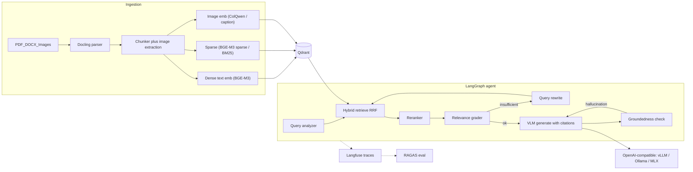

# agentic-rag-local

Local multimodal **agentic RAG**: LangGraph orchestration, Qdrant hybrid search, a
cross-encoder reranker, a pluggable OpenAI-compatible LLM layer (vLLM by default, Ollama or
MLX on a Mac), Hugging Face model downloads, Langfuse traces and a RAGAS evaluation gate.

With the default settings the whole stack runs on your own hardware: the LLM (vLLM on an
NVIDIA GPU, or Ollama/MLX on a Mac), BGE-M3 embeddings, the reranker and Qdrant. Models are
downloaded from Hugging Face once. Prompts leave the machine only if you point the LLM layer
at a remote API (for example the `openai` backend), and traces go to the Langfuse instance
set in `.env` (`make up` and `make up-gpu` start a local one).

Design decisions live in [`docs/adr/`](docs/adr/).

## Features

- **Agentic loop** — analyze → hybrid retrieve → rerank → CRAG grade → query rewrite → generate with citations → Self-RAG groundedness check
- **Hybrid search** — BGE-M3 dense + sparse, ColQwen image multivectors, RRF fusion in Qdrant
- **Multimodal** — PDF/DOCX/images in, VLM answers over retrieved figures
- **Any open-source model** — `rag models pull <org/name>` from Hugging Face
- **Same app on GPU server and Mac** — vLLM on an NVIDIA GPU by default; Ollama or MLX on a Mac through env vars
- **Eval gate** — `make eval` runs a golden set through RAGAS and exits 1 if a metric is below its threshold (a manual GitHub workflow, not part of the CI on every push)



See [docs/architecture.md](docs/architecture.md) for the layer-by-layer write-up.

## Quickstart

The default backend is vLLM. You need Python 3.11–3.13, [uv](https://docs.astral.sh/uv/),
Docker with the NVIDIA Container Toolkit, and an NVIDIA GPU that fits Qwen3-VL-8B (the bf16
weights alone are about 17 GB, so plan for 24 GB of GPU memory or more; an estimate).

```bash
cp .env.example .env
make setup
make up-gpu             # Qdrant, Langfuse and vLLM (v0.31.0); first start downloads Qwen3-VL-8B
make logs               # wait until vLLM reports that the server is ready
make models             # BGE-M3, reranker, ColQwen (several GB)
make ingest             # indexes eval/corpus
make query Q="What is the peak efficiency of the Helios H5?"
make ui                 # Gradio chat with image upload
```

`make eval` runs the golden set through the agent and RAGAS and exits 1 if any
threshold in `configs/settings.yaml` is missed. Set `VLLM_IMAGE_TAG` to try another vLLM
release.

### Mac (no NVIDIA GPU)

vLLM's Apple Silicon plugin ([vllm-metal](https://docs.vllm.ai/projects/vllm-metal/en/latest/))
focused on text-only models as of October 2026, and this project needs a vision model. On a
Mac, start Qdrant and Langfuse with `make up` and serve the model with Ollama or MLX:

```bash
make serve-llm-ollama   # then in .env:
# RAG_LLM__BACKEND=ollama
# RAG_LLM__BASE_URL=http://localhost:11434/v1
# RAG_LLM__MODEL=qwen3-vl:8b

make serve-llm-mlx      # or MLX, then in .env:
# RAG_LLM__BACKEND=mlx
# RAG_LLM__BASE_URL=http://localhost:8080/v1
# RAG_LLM__MODEL=mlx-community/Qwen3-VL-8B-Instruct-4bit
```

Application code does not change. That is [ADR 0002](docs/adr/0002-provider-abstraction.md).

## Hugging Face models

```bash
rag models pull BAAI/bge-m3
rag models pull Qwen/Qwen3-VL-8B-Instruct --include "*.safetensors" --include "*.json"
rag models pull meta-llama/Llama-3.1-8B --mlx          # gated: set HF_TOKEN first
rag models pull-all                                    # enabled rows in configs/models.yaml
rag models list
```

Gated repos print the license and refuse to download until you accept it on the Hub
and export `HF_TOKEN`.

## API

```bash
make serve
curl -s localhost:8800/query -H 'content-type: application/json' \
  -d '{"question":"What is the hotel cap in Paris?"}'
```

| Method | Path | Purpose |
|---|---|---|
| POST | `/query` | JSON answer + citations |
| POST | `/query/stream` | SSE: `node`, `token`, `final` |
| POST | `/ingest` | multipart file upload |
| GET | `/health`, `/stats` | liveness and collection size |

## Evaluation

Golden set: [`eval/datasets/golden.jsonl`](eval/datasets/golden.jsonl) (12 questions over
the Helios H5 manual, the travel policy and an efficiency chart).

| Metric | Threshold |
|---|---|
| faithfulness | 0.75 |
| answer_relevancy | 0.70 |
| context_precision | 0.65 |
| context_recall | 0.70 |
| source_recall | reported, not gated |
| multimodal_faithfulness | reported on samples that retrieve images |

No scores are published yet: they depend on the LLM, the embedding models and the hardware.
`make eval` writes a report with each score next to its threshold to `eval/results/latest.md`
and pushes it to Langfuse when it is up.

## Tests

```bash
make test                 # unit tests, no Docker, no models
make test-integration     # Qdrant via testcontainers
make check                # ruff + pyright + unit tests
```

CI runs on every push: ruff, pyright, unit tests on Python 3.11 and 3.12, integration tests
with Qdrant, and a gitleaks scan of the full history. The RAGAS evaluation
(`.github/workflows/eval.yml`) is started by hand and needs an LLM endpoint in the
`RAG_LLM_BASE_URL` secret.

## Layout

```
configs/           settings.yaml, models.yaml
src/agentic_rag/   config, providers, embeddings, ingestion, retrieval, agent, api, ui
eval/              corpus, golden.jsonl, RAGAS runner
docs/adr/          architecture decisions
```

## License

Apache-2.0. Individual models have their own licenses; the downloader prints them.
